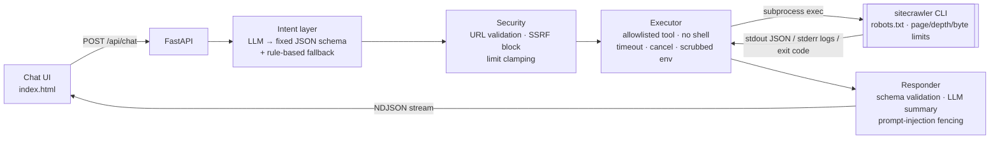

# ClawCLI: an AI chat app that executes, not just talks

ClawCLI turns a natural-language request ("crawl this site, summarise it, give me JSON") into a **validated, sandboxed CLI process** started by the backend. It streams the live logs, captures **stdout, stderr and the exit code**, validates the output, and returns a **summary plus structured JSON** in the chat, along with honest success, partial or failed status.

## Architecture



**Event stream to the UI:** `plan → exec_start → log… → exec_end → result | error`

| Layer | File | Role |
|---|---|---|
| Chat UI | `frontend/index.html` | Shows the plan, a live terminal, status badges, the summary, and a JSON viewer with copy and download |
| API | `backend/app/main.py` | Streaming endpoint, rate limit, concurrency cap, cancel endpoint |
| Intent | `backend/app/intent.py` | NL → `TaskPlan` (intent, url, max_pages, max_depth, focus) |
| Security | `backend/app/security.py` | URL allowlist, DNS-resolved SSRF block, secret redaction |
| Executor | `backend/app/executor.py` | `asyncio.create_subprocess_exec` with an allowlist, timeout and kill |
| Responder | `backend/app/responder.py` | Validates the CLI JSON, summarises it, builds the final JSON |
| CLI | `cli/sitecrawler.py` | Standalone crawler (standard library only) |

## Quick start

```bash
git clone <repo> && cd clawcli
python -m venv .venv && source .venv/bin/activate   # Windows: .venv\Scripts\activate
pip install -r requirements.txt
cp .env.example .env        # optional: add ANTHROPIC_API_KEY
export $(grep -v '^#' .env | xargs)  # or set the variables manually
uvicorn backend.app.main:app --port 8000
```
Open http://localhost:8000 and click **example.com demo**.

**Docker:** `docker build -t clawcli . && docker run -p 8000:8000 --env-file .env clawcli`

**Run the CLI directly:** `python cli/sitecrawler.py --url https://example.com --max-pages 5 --max-depth 1`

### Environment variables
| Var | Default | Purpose |
|---|---|---|
| `ANTHROPIC_API_KEY` | empty | Enables LLM intent parsing and summaries (optional; the app works without it) |
| `LLM_MODEL` | `claude-sonnet-5-5` | Claude model ID |
| `CLI_TIMEOUT_SEC` | `90` | Hard kill timeout for each CLI run |
| `ALLOW_PRIVATE_HOSTS` | `false` | Set to `true` only to test against a local server |

## The CLI tool: `sitecrawler`
Why a custom CLI? It is dependency-free, so it runs in any sandbox. It has a **strict machine contract**, and it lets us enforce crawl limits at the source.
- **stdout:** exactly one JSON document
- **stderr:** `[crawl] …` progress lines, streamed live to the chat
- **exit codes:** `0` success · `2` invalid args · `3` unreachable · `4` blocked by robots.txt · `10` partial
- Same-domain breadth-first crawl, robots.txt respected, ≤50 pages, depth ≤3, 2 MB per page, 10 s per request, politeness delay

## Test the demo
1. **Mandatory demo:** `Crawl https://example.com, extract the important information, give me a summary, and return the extracted data in JSON format.`
2. **Richer site:** `Crawl https://books.toscrape.com 6 pages depth 1`
3. **Edge cases:** `Crawl http://localhost:8000/admin` (blocked by SSRF protection) · `Crawl https://this-domain-does-not-exist-xyz.com` (DNS failure) · click **cancel** during a run · set `CLI_TIMEOUT_SEC=3` to see a timeout.

## Security
- No shell: `create_subprocess_exec` with an argv list. User and model text never becomes a command.
- An **allowlist of tools**. The LLM only fills a fixed JSON schema, and every value is clamped in code.
- URL validation: http(s) only, no credentials, standard ports only, shell metacharacters rejected, and a **DNS-resolved private, loopback and metadata IP block** (SSRF).
- Limits: pages, depth, bytes, per-request timeout, global CLI timeout, 3 concurrent runs, 10 requests per minute per IP.
- The child process runs with a **scrubbed environment**, so no API keys reach it. In Docker it also runs as a non-root user.
- Web content is fenced as `<crawl_data>` and marked untrusted for the LLM, so prompt injection cannot trigger tools.
- Secrets are redacted from logs and errors, and status is reported honestly (success, partial, failed, timeout, cancelled, blocked).

## AI tools disclosure
- **Claude (Anthropic API)** is used at runtime for intent parsing and summaries. Without a key, the app falls back to its rule-based parser and extractive summaries.
- **Claude** was also used as an AI coding assistant to build this project. All the code has been reviewed and is explained in the demo video.
